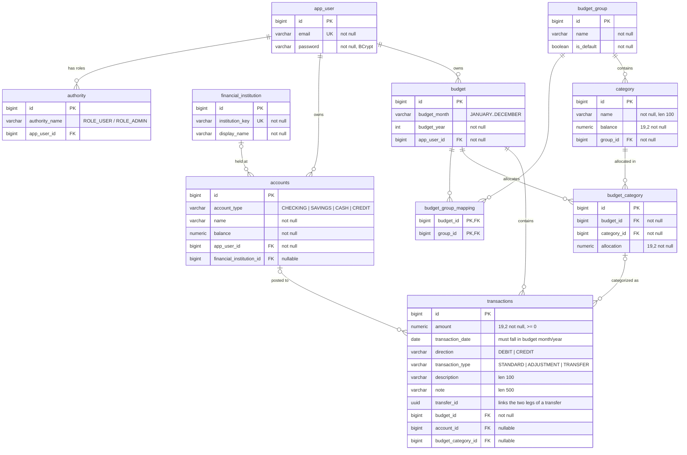

# Database ERD

Generated from the JPA entities in `src/main/java/com/kmercoders/nkap/`. Table and column names are the physical names produced by Spring Boot's default naming strategy (camelCase → snake_case).

## Constraints and notes

- **Unique keys**: `app_user.email`; `budget (app_user_id, budget_month, budget_year)` — one budget per user per month; `budget_category (budget_id, category_id)`; `financial_institution.institution_key`.
- **Budget ↔ Group** is many-to-many through `budget_group_mapping` (owned by `Budget.groups`).
- **Transactions attach to `budget_category`, not `category`**, so the same category can carry a different allocation and transaction set in each monthly budget.
- **`budget_group` and `category` have no `app_user_id`**: ownership is only reachable through `budget_group_mapping → budget → app_user`. A group not linked to any budget has no owner.
- **Cascades (JPA, not DB-level)**: deleting an `app_user` removes their budgets and accounts; deleting a `budget` removes its `budget_category` rows and transactions; deleting a `budget_group` removes its categories; deleting a `category` removes its `budget_category` rows, which in turn remove their transactions; deleting an `account` removes its transactions.
- `id` on `app_user`, `accounts`, and `authority` uses `GenerationType.AUTO` (sequence-backed); all other tables use `IDENTITY`.
